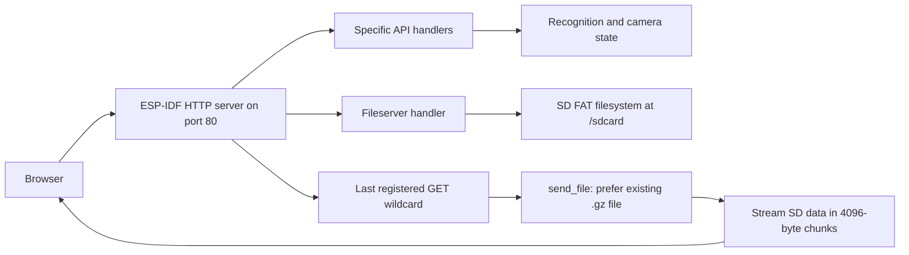

# Current system and SD-card hosting

Evidence is from source baseline `cdc8450924e9338ab564c3fd76ad998e7b7cbb84`. Device behavior has not been measured. Source-derived conclusions and proposed changes are distinguished below.

This describes the current firmware, not the planned cache behavior. ETags, `no-cache` revalidation and necessary small API extensions are now agreed work; see [08-cache-and-firmware-support.md](08-cache-and-firmware-support.md).

## Request flow

[main.cpp](../../code/main/main.cpp) mounts the FAT card at `/sdcard` through `esp_vfs_fat_sdmmc_mount`; it allows 12 open filesystem files and does not format on mount failure. The default build uses one-line SD mode, defined in [defines.h](../../code/include/defines.h).

The application starts the server, registers camera/flow/files/OTA/optional MQTT/GPIO handlers, then registers the main routes last. In [server_main.cpp](../../code/main/server_main.cpp), `hello_main_handler` handles remaining GET requests:

| Browser request | Resolution |
| --- | --- |
| `/` | `/sdcard/html/index.html` |
| `/index.html` | Same file, with special setup and critical-error checks |
| `/overview.html` | `/sdcard/html/overview.html` |
| `/common.js?v=...` | `/sdcard/html/common.js`; query removed from filesystem path |
| `/ui/index.html` | Expected `/sdcard/html/ui/index.html`, using the same wildcard; requires device verification |
| `/ui/` | No automatic nested index lookup is implemented; do not use as the canonical entry |
| `/ui/history` | A literal file lookup, not SPA navigation; use hash routes instead |
| `/fileserver/config/config.ini` | Separate file handler serves `/sdcard/config/config.ini` |
| `/img_tmp/alg_roi.jpg` | Virtual image handler tries recognition data in RAM, then SD fallback |

Only the root legacy `index.html` receives the server's special behavior: critical hardware/SD errors can produce an inline recovery page; active setup mode substitutes `setup.html`. A nested alternative entry will not inherit those checks. It must provide its own setup/recovery navigation based on available information and retain a direct legacy-root link.

## Static delivery and compression

[server_help.cpp](../../code/components/jomjol_fileserver_ota/server_help.cpp), `send_file`:

1. Checks for `<requested-path>.gz` first, regardless of `Accept-Encoding`.
2. Uses the original extension for MIME selection when that sibling exists.
3. Sets `Content-Encoding: gzip` for the sibling and serves the compressed bytes unchanged.
4. Reads and sends chunks through a 4096-byte scratch buffer; it does not load the complete asset or run a frontend runtime.
5. Sets `Cache-Control: max-age=43200` for its listed static extensions: 12 hours, including HTML and `.gz`.

Gzip here happens during packaging, not on the ESP32. Browser decompression and UI execution happen on the client. Smaller files primarily reduce Wi-Fi transfer, SD reads, and time occupied in the HTTP handler; do not claim a proportional reduction in ESP32 heap.

Limitations to account for:

- No ETag/Last-Modified conditional handling or Brotli sibling selection appears in this helper.
- `.js`, `.css`, `.html`, JPEG and PNG are recognized; `.mjs`, `.svg`, `.woff2`, `.json` are not and fall back to `text/plain`. Use `.js` modules, system fonts, and inline SVG or supported image files. A JSON body can still be fetched as text and parsed when necessary.
- The setup exception compares the selected filename to `/sdcard/html/setup.html`. A gzip sibling changes that filename, so do not assume `Clear-Site-Data` is reliably emitted for compressed setup.
- Static HTML also caches for 12 hours. Hashing child assets alone does not refresh a cached entry document.
- Explicit requests for a `.gz` URL are different from requesting the logical `.js` or `.html` URL. Browsers must request the logical URL and receive encoding headers.

## Resource and runtime constraints

| Setting / behavior | Source value | Implication |
| --- | --- | --- |
| HTTP sockets | 5, with LRU eviction | Keep asset fan-out low and application requests bounded |
| HTTP task | 12288-byte stack, core 1 | Avoid adding server-side rendering or compression |
| Receive/send timeout | 5 seconds each | Long transfers and weak Wi-Fi need explicit states and bounded retries |
| Registered handler capacity | 41 | Add no new handlers for the initial alternative |
| Static/fileserver buffers | 4096 bytes each | Delivery already streams; bundle size is not equal to heap allocation |
| Upload maximum | `8000 * 1024` bytes, labeled "8MB" | Mirror the exact byte limit in validation |
| `/log` and `/data` tail | Up to 80 KiB before line alignment | Tail is bounded but not tiny; do not poll frequently |
| Static/image path buffer | 50 bytes in main handlers | Keep generated URL paths short and verify actual handling |
| `/editflow` arguments | 512-byte query, many 30-byte value buffers | Respect existing calibration filename/parameter lengths |

There is an unusual `get_path_from_uri(..., req->uri - 1, ...)` call in the main static handler. Its pointer arithmetic reads before the URI pointer; the generated file path is later constructed separately. Record this as an existing correctness risk, not proof that every nested path works. A serving compatibility check is a prerequisite; isolate any necessary firmware correction into a separately reviewed change.

`CCamera::CaptureToStream` in [ClassControllCamera.cpp](../../code/components/jomjol_controlcamera/ClassControllCamera.cpp) sends multipart JPEG frames in a loop inside the request handler. Both firmware and legacy UI comments call it blocking. It runs until sending fails/disconnects, then turns the lights off. The target interval is 500 ms (`CAM_LIVESTREAM_REFRESHRATE`). Five sockets do not mean five independently executing camera/API handlers. Load stream controls before starting; pause other traffic and disconnect the image before trying API-based stop/navigation actions.

## Legacy frontend structure

[index.html](../../sd-card/html/index.html) is a menu shell using an iframe and a root-scoped `page` cookie to remember the page. Most pages have inline scripts/styles, share helper scripts, and several use jQuery and synchronous XHR.

- Overview starts four `/value?all=true&type=...` requests plus six status/diagnostic requests and an ROI image. Its refresh loop is 300000 ms. The shell additionally requests hostname/versions and loads config to decide Home Assistant menu visibility.
- Structured configuration is based on `readconfigparam.js` and `readconfigcommon.js`; it is custom INI parsing and serialization, not a JSON configuration API.
- Reference/alignment/digit/analog editing uses canvas coordinates and writes image/config files through legacy endpoints.
- Graphs use Plotly Basic; archive creation for backup/export uses JSZip in the browser.
- Directory listings and full recognition output are HTML generated by firmware.

An iframe does not automatically force every shared dependency to be transferred again: HTTP caching can reuse bytes. It still complicates navigation, page state, accessibility, repeated initialization, and independent page requests. Measure actual network behavior before claiming savings.

## Build and update lifecycle

[sd-card/Readme.md](../../sd-card/Readme.md) explicitly warns that `sd-card/html` is template input, not the finished release UI.

[build.yaml](../../.github/workflows/build.yaml) currently:

1. Builds firmware through PlatformIO.
2. Copies the SD HTML input to a staging `html/` directory.
3. Runs [generate-param-doc-tooltips.py](../../tools/parameter-tooltip-generator/generate-param-doc-tooltips.py), generating `edit_config.html` and injecting parameter help into configuration/reference pages. The generator writes into the source HTML directory during CI.
4. Re-copies those generated inputs and removes the template.
5. Substitutes `$COMMIT_HASH`, then gzips HTML, CSS, JS, JPG, PNG, SVG and map files; the gzip command removes the original files.
6. Packs the generated HTML in OTA, remote-setup and manual SD-install artifacts; also packages models/demo content where appropriate.

ZIP OTA in [server_ota.cpp](../../code/components/jomjol_fileserver_ota/server_ota.cpp) extracts into `/sdcard/html_tmp`, renames `/sdcard/html` to `html_old`, installs the temporary folder, then deletes the old folder. **A manually added `/html/ui` can disappear on the next OTA.** Production packages must contain both UIs. An update ZIP containing only the new subfolder can remove the legacy pages; do not use that as an additive installer.

The alternative build should join staging before archives are assembled and be compressed exactly once. Do not feed its binary `.gz` files through the blanket text substitution step. Prove nested extraction, directory creation and package membership in integration checks.

## Separate firmware-hosted setup

[softAP.cpp](../../code/main/softAP.cpp) provides an embedded access-point provisioning/recovery server with its own routes and HTML. It is distinct from the SD-card setup wizard. The alternative static UI cannot replace it simply by adding files to `/html/ui`. Preserve this path; any redesign of the embedded AP experience is a separate firmware scope decision.

## Main source map

| Area | Files |
| --- | --- |
| HTTP mounting/routing | `code/main/main.cpp`, `code/main/server_main.cpp` |
| Authentication | `code/components/jomjol_wlan/basic_auth.cpp` and `.h` |
| Static types/gzip/ZIP extraction | `code/components/jomjol_fileserver_ota/server_help.cpp` |
| Files, directory HTML, upload/delete, tails | `code/components/jomjol_fileserver_ota/server_file.cpp` |
| Updates/reboot | `code/components/jomjol_fileserver_ota/server_ota.cpp` |
| Readings/control/calibration routes | `code/components/jomjol_flowcontroll/MainFlowControl.cpp` |
| Reading JSON | `code/components/jomjol_flowcontroll/ClassFlowPostProcessing.cpp`, `GetJSON` / `getJsonFromNumber` |
| Dynamic recognition images | `code/components/jomjol_flowcontroll/ClassFlowControll.cpp` |
| Camera stream | `code/components/jomjol_controlcamera/ClassControllCamera.cpp` |
| Legacy pages | `sd-card/html/` |
| Parameter help | `param-docs/parameter-pages/`, tooltip generator |
| Packaging | `.github/workflows/build.yaml` |
